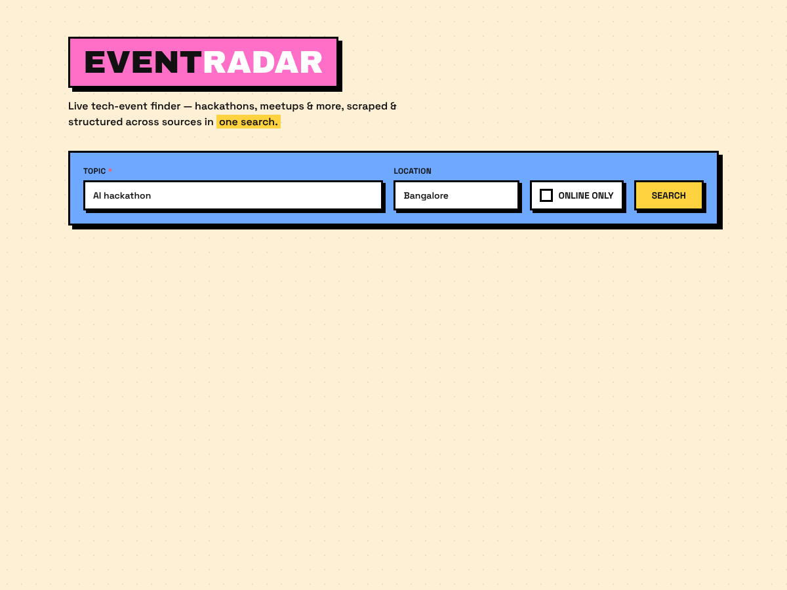
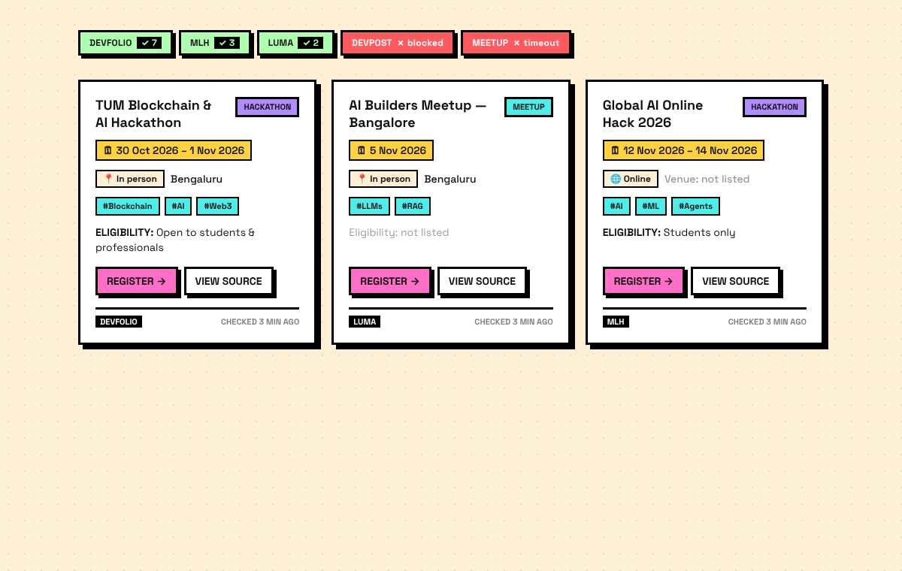

# EventRadar

A one-page tech-event finder. Enter a **topic** (and optionally a location), hit
Search, and EventRadar fans out across several event sources in parallel, reads
each page with the [TinyFish](https://tinyfish.ai) Fetch/Search API, extracts
structured events with Gemini, and shows honest, de-duplicated result cards —
with a per-source status strip so you can see exactly what succeeded and what
didn't.

Built as a 1-hour hackathon MVP: **one** end-to-end flow, no auth, no database,
no notifications. The UI uses a **neobrutalist** design — thick black borders,
hard offset shadows, bright accents and bold type.

| Search | Results |
|--------|---------|
|  |  |

📖 **Full technical documentation:** [`DOCS.md`](./DOCS.md) — architecture, every
module, the API contract, the data model, and the design system.

## Stack

- **Next.js 15** (App Router) + **TypeScript** + **Tailwind CSS**
- **TinyFish SDK** (`@tiny-fish/sdk`) — Search + Fetch (+ optional Agent)
- **Google Gemini SDK** (`@google/genai`) — extraction with `gemini-2.5-flash`
- **zod** — validates every extracted event

All API keys stay **server-side**: they are read from the environment inside the
API route / server modules and are never exposed to the browser.

## Setup

```bash
cd eventradar
npm install

# add your keys
cp .env.example .env.local
#   TINYFISH_API_KEY=...        (https://tinyfish.ai)
#   GEMINI_API_KEY=...          (free key at https://aistudio.google.com/apikey)

npm run dev
# open http://localhost:3000
```

Then search e.g. **topic** `AI hackathon`, **location** `Bangalore`.

> Both keys are required for live results. Without them the API route returns a
> clear, graceful error (e.g. *"TINYFISH_API_KEY is not set"*) and the UI shows
> it in a banner instead of crashing.

## How it works — the pipeline (`lib/pipeline.ts`)

```
Query ──▶ A. Fixed source URLs   (Devfolio, MLH, Luma, Meetup, Devpost)
      ──▶ B. TinyFish Search     (top 5 new URLs, not already fixed)
      ──▶ C. TinyFish Fetch      (markdown + links, ≤10 URLs/call, ttl 3600,
      │                           per-URL failures recorded, never fatal)
      ──▶ D. LLM extraction      (gemini-2.5-flash → JSON, zod-validated,
      │                           retry once on bad JSON, else skip page)
      ──▶ E. Post-process        (drop no-name/past, topic + location filter,
                                  dedupe by name+date keeping the richer record,
                                  sort by start date)
```

**Honesty rules baked in:**

- The extraction prompt is told: *"Use only text present in the page. If a field
  is absent, return null. Never guess dates or eligibility."*
- Missing data is always shown as **"Not listed"** — never back-filled from
  another source.
- **Devfolio** prints dates as `DD/MM/YY`; `lib/dates.ts` parses that format
  specifically (the model is warned about it too).
- A location search is **alias-aware** — "Bangalore" matches "Bengaluru",
  "Bombay" matches "Mumbai", etc.

### API

```
GET /api/events?topic=<required>&location=<default India>&online=<true|false>
```

Returns:

```jsonc
{
  "query":   { "topic": "...", "location": "...", "online": false },
  "events":  [ /* Event objects */ ],
  "sources": [ { "name": "Devfolio", "url": "...", "ok": true, "count": 12, "error": null }, ... ],
  "errors":  [ "Devpost: blocked", ... ],   // for the error banner
  "tookMs":  8421
}
```

### Event schema (`lib/types.ts`)

```ts
{
  name, start_date, end_date, date_text, mode, venue_or_city, event_type,
  themes[], eligibility, registration_url, source_url, source_name,
  fields_missing[], fetched_at
}
```

## UI

- **Search form** — topic (required), location (default *India*), *Online only* toggle.
- **Status strip** — `Devfolio ✓ 12 · Devpost ✗ blocked`, each chip links to the source.
- **Skeleton cards** while fetching.
- **Event cards** — type chip, parsed date (raw text in a tooltip), mode + venue,
  up to 3 theme tags, eligibility (or grey *"Eligibility: not listed"*),
  **Register** (hidden when absent) and **View source** (always), footer with
  source name + *"checked N min ago"*.
- **Toolbar** — result count, sort (date / source), filter chips
  (Online, Offline, Hackathon, Meetup).
- **Empty state** suggests broadening the topic or removing the location.
- **Error banner** lists failed sources *while still showing* the results that
  did come back.

## Optional: Unstop via the Agent API

`https://unstop.com/hackathons` blocks plain fetching, so it's read with the
TinyFish **Agent** API using a `stealth` browser profile and an output schema.
It's **off by default** (it spends agent credits and adds latency); enable it with:

```bash
EVENTRADAR_ENABLE_UNSTOP=1
```

Per the brief, a result containing `captcha`/`blocked` is treated as a **failure**
even when the run status is `COMPLETED`.

## Scripts

```bash
npm run dev        # dev server
npm run build      # production build
npm run start      # serve the production build
npm run typecheck  # tsc --noEmit
```

## Notes / trade-offs (1-hour MVP)

- Luma uses its canonical `lu.ma/<city-slug>` host.
- Devpost's unofficial JSON endpoint is fetched as text and read by the LLM
  (best-effort, as specified).
- Page text sent to the model is capped (~14k chars) to keep latency/cost bounded.
- The pure data-shaping logic (dates, source URLs, post-process) is covered by a
  standalone assertion test; the live fetch shape was validated against Devfolio.
